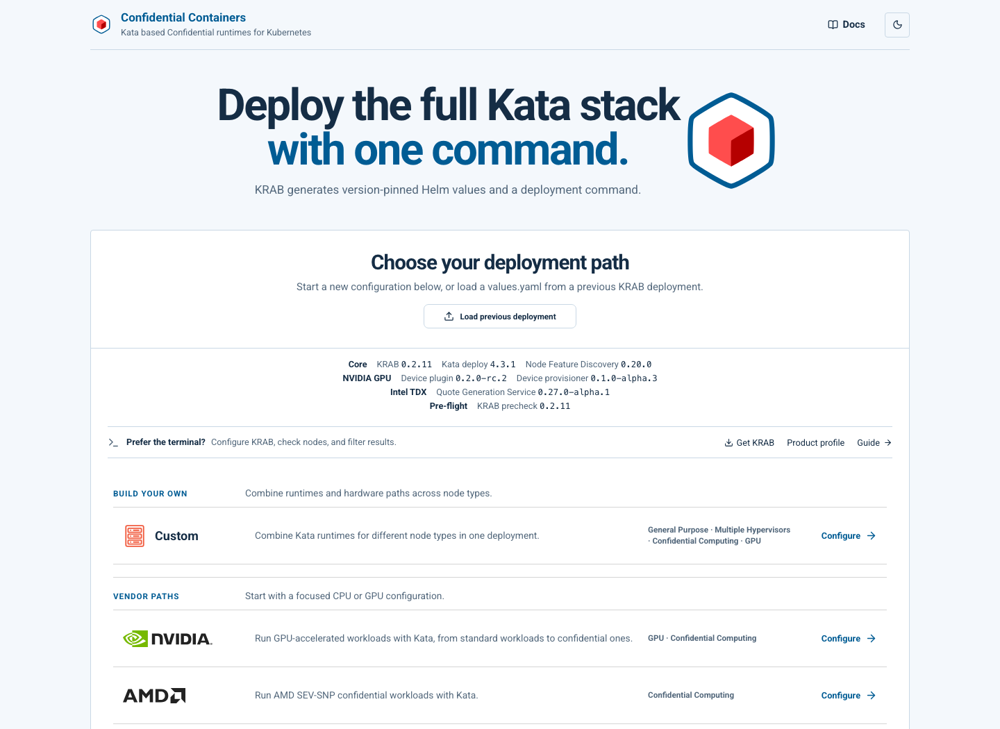

# Confidential Containers demo

A CoCo-branded KRAB site for the proposed Rust runtime migration. It uses the
shared KRAB website, native CLI, and generation engine. The product JSON replaces
the branding, colours, available options, and defaults; there is no separate frontend.
The site retains **Powered by KRAB** attribution. This is a demonstration, not an official CoCo distribution.



## Run it

From the KRAB repository root:

```sh
docker compose -f demo/confidential-containers/compose.yaml up --build
```

Open **http://localhost:8080**. Edit `krab-profile.json` and reload to change the
options or light/dark colours. The profile and logo are mounted into the existing
static website container, so those changes do not need an image rebuild.

For any portable KRAB static-site artifact, copy this profile to
`krab-profile.json` beside `index.html` and copy
`src/assets/brands/confidential-containers.svg` to `product-logo.svg` in that directory.
Serve those files with any static host; a subdirectory also works with the portable artifact.

## Available choices

The scope follows [confidential-containers/charts](https://github.com/confidential-containers/charts/tree/7c01d2a227f6f11688e2e99121c6405acb357569),
chart **0.23.0**, adapted to KRAB's Rust runtime IDs:

| CoCo deployment intent | KRAB runtime | Architecture |
| --- | --- | --- |
| AMD SEV-SNP | `qemu-snp-runtime-rs` | amd64 |
| Intel TDX | `qemu-tdx-runtime-rs` | amd64 |
| IBM Secure Execution | `qemu-se-runtime-rs` | s390x |
| NVIDIA GPU with SNP | `qemu-nvidia-gpu-snp-runtime-rs` | amd64 |
| NVIDIA GPU with TDX | `qemu-nvidia-gpu-tdx-runtime-rs` | amd64 |
| Development/testing | `qemu-coco-dev-runtime-rs` | amd64, s390x |

Intel, AMD, IBM, NVIDIA, and Custom remain visible deployment paths.
All five distributions from the CoCo chart are available: kubeadm, k0s, k3s,
MicroK8s, and RKE2. The starting configuration selects the amd64 SNP, TDX, and
development runtimes, using release `coco` and namespace `coco-system`.
NVIDIA GPU runtimes are optional, selected through KRAB's HGX Blackwell, HGX
Hopper, and PCIe GPU profiles. Passthrough-only GPU modes are excluded by the
runtime allowlist. The development runtime provides no hardware TEE.

Advanced runtime, scheduling, debug, and image controls remain available.
Custom runtimes, component toggles, raw Helm overrides, continuous conformance,
and scheduled node enrollment are hidden and held at their defaults for this product.
Operators can change the feature flags in the profile.

Peer-pods is outside this profile. This site proposes Rust runtime choices for
CoCo's migration; it currently generates **KRAB** chart values and install commands.
It does not translate values into the official CoCo chart's
`kata-as-coco-runtime`/`peerpods` format. The matching KRAB release supplies the
pinned Kata/catalog versions.

## Use the same options in the CLI / TUI

```sh
krab --profile demo/confidential-containers/krab-profile.json list catalog --json
krab --profile demo/confidential-containers/krab-profile.json init \
  --non-interactive --output coco.yaml
krab --profile demo/confidential-containers/krab-profile.json edit --config coco.yaml
krab --profile demo/confidential-containers/krab-profile.json generate \
  --config coco.yaml --output values.yaml
```

Use the same KRAB version for the site and CLI. For a bundled CLI distribution,
place this file beside the binary as `krab-profile.json`.
